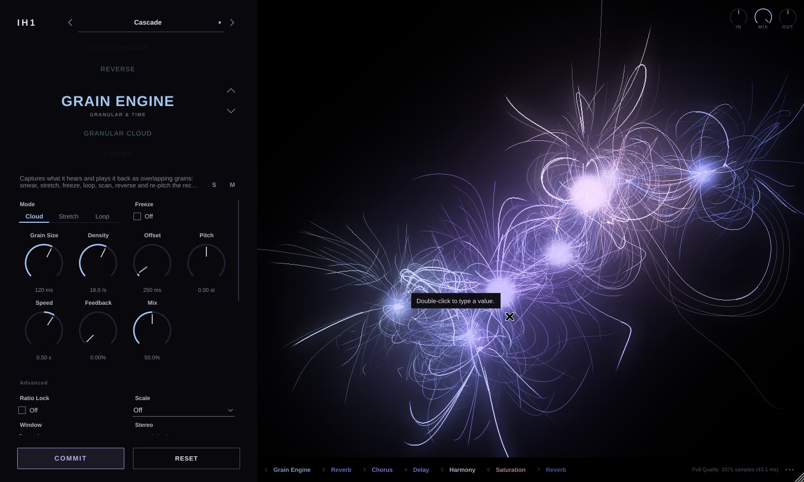

# IH1

A creative VST3 multi-FX plug-in built around a **commit workflow**. You scroll to an effect, shape it while it plays after everything you've already committed, then **COMMIT** it into an immutable serial chain. Each committed effect can be reordered or deleted but never edited, and the chain grows into an audio-reactive force field.



## Status

Version 0.3.0 (test build, feedback round 3), with the V1 feedback pass, the V2.1 pass and the **V3 pass** applied. V3 is documented in `docs/V3_IMPLEMENTATION.md`. V2.1 is documented in:
- `docs/V2_1_IMPLEMENTATION.md`: diagnosis, changes, latency table, measurements, evidence, KADAL sources
- `docs/FL_STUDIO_TEST_CHECKLIST.md`: the manual host acceptance list (FL Studio not tested here)
- `docs/KNOWN_ISSUES.md` and `docs/FACTORY_PRESETS.md`

The earlier V1 feedback pass is documented in:
- `docs/V1_FEEDBACK_TRIAGE.md`
- `docs/V1_FEEDBACK_IMPLEMENTATION.md`
- `docs/QA_AND_REGRESSION_RESULTS.md`
- `docs/KNOWN_ISSUES.md`
- `docs/FACTORY_PRESETS.md`

- **39 effects** — the full catalogue, including the new **Grain Engine** (Cloud / Stretch / Loop, Freeze, varispeed, synced retrigger, scale quantise, Smooth Splice, grain feedback) — are implemented and tested. Each one has a behaviour test as well as the shared contract suite. The list, algorithms and measurements are in `docs/FX_CATALOGUE.md`.
  - **Time & space:** Delay, Tape Echo, Reverb (7 algorithms), Reverse (3 modes), Shimmer, Convolution, Doppler
  - **Pitch & voice:** Harmony (intervals / key & scale / MIDI), Pitch Shift, Formant Shift, Doubler, Pitch Correction, Vocoder
  - **Modulation:** Chorus, Flanger, Phaser, Vibrato, Tremolo/Pan, Filter/Wah, Ring Mod, Rotary, Frequency Shifter
  - **Texture & spectral:** Grain Engine, Granular Cloud, Spectral Freeze, Stutter, Looper, Resonator
  - **Tone & dynamics:** EQ / Dynamic EQ, Saturation, Stereo Width, Compressor, Gate/Expander, De-Esser, Transient Shaper, Tape/Console, Bitcrusher, Exciter, Amp/Cabinet
- **Workflow:**
  - carousel with a nested category menu, per-type drafts, SOLO / MUTE, COMMIT / RESET, drag reorder, DELETE with confirmation;
  - **Clear FX Chain** with confirmation;
  - **Full Quality / Low Latency / Zero Latency** modes;
  - **66 factory presets** in 10 categories, plus user presets;
  - DAW state recall.
- **Tested on Linux:**
  - 101 unit, behaviour and audit test cases;
  - `ih1_hosttest`, 56 checks through the real VST3, including reported == measured latency;
  - `ih1_uitest`, 72 editor checks;
  - pluginval at strictness 8 and 10;
  - ASan / UBSan / TSan;
  - a 30-minute soak (`ih1_soak`).
- **Windows builds:** CI builds, tests and packages a setup wizard. pluginval at strictness 5 passes on Windows (CI) and Linux.
- **Not yet tested:** FL Studio 25 and Cubase 14. See *Known limitations*.

## Install (Windows)

1. Download `IH1-Setup-<version>.exe` from the latest **build** workflow run (artifact `IH1-windows-setup`) in GitHub Actions.
2. Run it. It installs `IH1.vst3` to `C:\Program Files\Common Files\VST3\` (the standard VST3 folder) and, optionally, the standalone app.
3. Rescan plug-ins:
   - FL Studio: *Options > Manage plugins > Find more plugins*.
   - Cubase: *Studio > VST Plug-in Manager*.

   IH1 appears as an effect from "R4N".
4. For Harmony's MIDI mode, route MIDI to IH1:
   - FL Studio: the plug-in's MIDI input port.
   - Cubase: a MIDI track whose output is IH1.

## Build from source

Requirements: CMake 3.22+, a C++20 compiler, Git.
- **Windows:** Visual Studio 2022 with *Desktop development with C++*.
- **Linux:** the ALSA/X11/freetype/OpenGL dev packages listed in `.github/workflows/build.yml`.

JUCE 9.0.5 and doctest are fetched automatically at pinned versions.

```bash
cmake -S . -B build -G "Visual Studio 17 2022" -A x64
```

```bash
cmake --build build --config Release --parallel
```

The build produces:
- `build/plugin/IH1_artefacts/Release/VST3/IH1.vst3`, the plug-in
- `build/plugin/IH1_artefacts/Release/Standalone/IH1(.exe)`, the standalone app
- `build/Release/ih1_tests(.exe)`, the unit and behaviour tests
- `build/plugin/ih1_hosttest_artefacts/Release/ih1_hosttest`, which loads the built VST3 and runs host-lifecycle checks
- `ih1_bench`, the CPU benchmark
- `formation_preview`, an offline render of the visual, e.g. `formation_preview out delay,reverb,harmony`
- `ih1_uitest`, the editor interaction test (needs a display: `xvfb-run` on Linux)
- `fx_dump`, which prints the FX parameter schema

To build the setup wizard locally, install Inno Setup 6, stage the files the same way CI does, then run `ISCC.exe /DAppVersion=0.3.0 /DTestRound=3 /DSourceDir=<stage> installer\IH1.iss`.

Optional: `-DIH1_JUCE_DIR=<path>` uses a local JUCE checkout instead of fetching it.

## Using IH1

- **Carousel:**
  - It shows `None` until you choose an effect.
  - Choose by scrolling the wheel over the names, with the ▲▼ arrows or the arrow keys, or by typing a name.
  - **Right-click** the carousel for the catalogue: categories open submenus beside them (hover, click, or arrow keys).
  - Every name is shown in the effect's colour, which it keeps in the formation.
  - Each effect type remembers its own draft settings.
- **Staged effect:** the selected effect plays *after* the committed chain. Its settings appear only while something is staged.
  - **S** (SOLO FX) plays only the staged effect.
  - **M** (MUTE FX) silences only the staged effect and greys the whole staged column until you unmute.
  - The staged effect never appears in the formation.
- **COMMIT** sends a frozen copy into the chain. A short transfer animation carries it into the formation, and the carousel returns to `None`.
- **RESET** restores the staged effect's defaults and clears what it holds, such as a Looper's recording or delay and reverb tails.
- **Settings:**
  - Graphs show the real response or state.
  - Double-click a knob to reset it, or double-click a value to type one.
  - Advanced controls are always visible under the *Advanced* label.
  - With **Sync** on, the free time or rate knob is greyed out (its value is kept); Division sets the time.
- **Chain strip** (under the formation):
  - Drag a name along the strip to reorder.
  - While dragging, a red **DELETE** appears at the upper-left of the field. Drop on it and confirm to remove that one instance. Escape, Cancel, or dropping anywhere else never deletes.
  - Hover a name for read-only details.
  - **···** at the right end of the strip (or right-click the strip) opens the chain options:
    - latency mode: Full Quality, Low Latency, or Zero Latency;
    - **Clear FX Chain…**, which always asks first. It removes every committed effect and keeps the staged one.
  - The quiet status next to it shows the latency reported to the host and, in Zero mode, which effect prevents strict zero.
- **Presets:**
  - The box in the header shows the current preset. Click the name to browse by category or search; ‹ › step through every preset and wrap.
  - Presets hold the committed chain.
  - User presets are saved to `Documents/IH1/Presets/*.ih1chain` (Save As, Save with confirmation, Rename, Delete).
  - Factory presets are read-only.
  - DAW projects additionally restore the staged draft, the selection, SOLO/MUTE and the editor size.
- **Host automation:** a fixed set of parameters — Bypass, SOLO, MUTE, Input / Output Gain, Global Mix, and Staged Control 1–8, which map to the staged effect's first eight controls. Committed effects are never automatable.
- **Without a GPU:** set `IH1_NO_OPENGL=1` to use the software formation. IH1 also switches to it automatically if OpenGL 3.2 is unavailable or a render target fails.

## Architecture and research

- `docs/ARCHITECTURE.md`: model, real-time handoff, state schema and parameters.
- `docs/KADAL_RESEARCH_MAP.md`: per-family research sources (KADAL IDs), chosen algorithms and gaps.
- `docs/VISUAL_REFERENCE_ANALYSIS.md`: measured analysis of the visual reference.
- `docs/OPEN_DECISIONS.md`: product decisions, all resolved.

The engine (`core/`) is plain C++20 with no JUCE dependency; `plugin/` is a thin JUCE 9 wrapper.

## Licensing

- **IH1:** the project's own licence has not been chosen yet; all rights are reserved by the owner.
- **JUCE 9:** used under the **JUCE 9 EULA, Starter tier**, which is free up to USD 20k revenue or funding. Move to Indie (or the AGPLv3 alternative) before passing that threshold.
- **VST3 SDK:** MIT.

- **Inno Setup:** the setup wizard is built with Inno Setup 6.7, which reports "Non-commercial use only". Buy an Inno Setup licence, or switch to NSIS or WiX, before selling IH1.

See `installer/THIRD_PARTY_NOTICES.txt`. VST is a registered trademark of Steinberg Media Technologies GmbH.

## Known limitations

See `docs/KNOWN_ISSUES.md` for the complete list. In short:

- **FL Studio is untested.** No V1 or V2.1 fix has been verified in FL Studio, and there is no DAW testing at all yet. Use `docs/FL_STUDIO_TEST_CHECKLIST.md`.
- **Display scaling is untested** at 125–200 %.
- **The visual is close to the reference, not identical.**
- **Spectral effects have no zero-latency variant.** Harmony, Pitch Shift, Formant Shift and Spectral Freeze add 2048 samples in Full Quality and 512 in Low; Zero mode names them.
- **Zero-mode saturation aliases more.** About 24 dB more at high drive, and Fold is very aliased. Low (5 samples) keeps full anti-aliasing.
- **The chain is capped at 32 effects.**
- **macOS is not built yet.**
