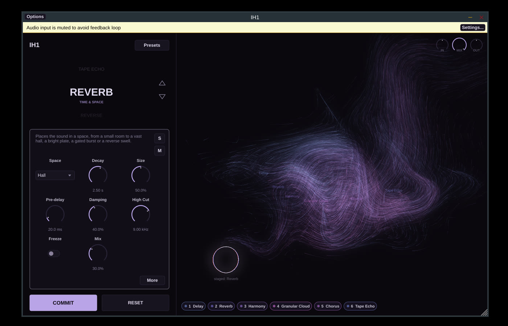

# IH1

A creative VST3 multi-FX plug-in built around a **commit workflow**. You scroll to an effect, shape it while it plays after everything you've already committed, then **COMMIT** it into an immutable serial chain. Each committed effect can be reordered or deleted but never edited, and the chain grows into an audio-reactive, filament-like formation.



## Status

Version 0.1.0 (development). Details are in `docs/PROJECT_STATUS.md`.

- **16 effects** (Batch A) are implemented and tested:
  - Delay, Tape Echo, Reverb (7 algorithms), Reverse (3 modes)
  - Harmony (intervals / key & scale / MIDI), Pitch Shift, Formant Shift, Doubler
  - Chorus, Filter/Wah, Granular Cloud, Spectral Freeze, Stutter
  - EQ / Dynamic EQ, Saturation, Stereo Width

  The full 37-type roadmap is in `docs/FX_CATALOGUE.md`.
- **Workflow:** carousel, per-type drafts, SOLO / MUTE, COMMIT / RESET, drag reorder, DELETE with confirmation, chain presets, and DAW state recall.
- **Tested on Linux:** 52 unit/behaviour test cases and a VST3 host-lifecycle suite.
- **Windows builds:** CI builds, validates (pluginval) and packages a setup wizard.
- **Not yet tested:** FL Studio 25 and Cubase 14. See *Known limitations*.

## Install (Windows)

1. Download `IH1-Setup-<version>.exe` from the latest **build** workflow run (artifact `IH1-windows-setup`) in GitHub Actions.
2. Run it. It installs `IH1.vst3` to `C:\Program Files\Common Files\VST3\` (the standard VST3 folder) and, optionally, the standalone app.
3. Rescan plug-ins:
   - FL Studio: *Options > Manage plugins > Find more plugins*.
   - Cubase: *Studio > VST Plug-in Manager*.

   IH1 appears as an effect from "R4N".
4. For Harmony's MIDI mode, route MIDI to IH1:
   - FL Studio: the plug-in's MIDI input port.
   - Cubase: a MIDI track whose output is IH1.

## Build from source

Requirements: CMake 3.22+, a C++20 compiler, Git.
- **Windows:** Visual Studio 2022 with *Desktop development with C++*.
- **Linux:** the ALSA/X11/freetype/OpenGL dev packages listed in `.github/workflows/build.yml`.

JUCE 9.0.5 and doctest are fetched automatically at pinned versions.

```bash
cmake -S . -B build -G "Visual Studio 17 2022" -A x64
```

```bash
cmake --build build --config Release --parallel
```

The build produces:
- `build/plugin/IH1_artefacts/Release/VST3/IH1.vst3`, the plug-in
- `build/plugin/IH1_artefacts/Release/Standalone/IH1(.exe)`, the standalone app
- `build/Release/ih1_tests(.exe)`, the unit and behaviour tests
- `build/plugin/ih1_hosttest_artefacts/Release/ih1_hosttest`, which loads the built VST3 and runs host-lifecycle checks
- `ih1_bench`, the CPU benchmark
- `formation_preview`, an offline render of the visual

To build the setup wizard locally, install Inno Setup 6, stage the files the same way CI does, then run `ISCC.exe /DAppVersion=0.1.0 /DSourceDir=<stage> installer\IH1.iss`.

Optional: `-DIH1_JUCE_DIR=<path>` uses a local JUCE checkout instead of fetching it.

## Using IH1

- **Carousel:** scroll the effect list with the mouse wheel, the ▲▼ arrows or the arrow keys, or type a name. Each effect type remembers its own draft settings.
- **Staged effect:** the selected effect plays *after* the committed chain.
  - **MUTE (M)** silences only the staged effect.
  - **SOLO (S)** plays only the staged effect, while the committed chain and its formation fade toward grey.
  - SOLO and MUTE are mutually exclusive.
- **COMMIT** appends a frozen copy to the chain and clears the selection. The draft keeps its values, so committing again makes a deliberate duplicate. **RESET** only resets the staged draft.
- **Formation field:**
  - Drag a pill in the chain lane, or a label in the field, to reorder.
  - Drop it on **DELETE** (top-right while dragging) and confirm to remove it. Escape, Cancel, or dropping anywhere else never deletes.
  - Hover for read-only details.
- **Presets** save and load the committed chain only (`Documents\IH1\Presets\*.ih1chain`). DAW projects also restore the staged draft, the selection and SOLO/MUTE.
- **Host automation:** a fixed set of parameters — Bypass, SOLO, MUTE, Input / Output Gain, Global Mix, and Staged Control 1–8, which map to the staged effect's first eight controls. Committed effects are never automatable.

## Architecture and research

- `docs/ARCHITECTURE.md`: model, real-time handoff, state schema and parameters.
- `docs/KADAL_RESEARCH_MAP.md`: per-family research sources (KADAL IDs), chosen algorithms and gaps.
- `docs/VISUAL_REFERENCE_ANALYSIS.md`: measured analysis of the visual reference.
- `docs/OPEN_DECISIONS.md`: product decisions, all resolved.

The engine (`core/`) is plain C++20 with no JUCE dependency; `plugin/` is a thin JUCE 9 wrapper.

## Licensing

- **IH1:** the project's own licence has not been chosen yet; all rights are reserved by the owner.
- **JUCE 9:** used under the **JUCE 9 EULA, Starter tier**, which is free up to USD 20k revenue or funding. Move to Indie (or the AGPLv3 alternative) before passing that threshold.
- **VST3 SDK:** MIT.

See `installer/THIRD_PARTY_NOTICES.txt`. VST is a registered trademark of Steinberg Media Technologies GmbH.

## Known limitations

- **No DAW testing yet.** Nothing has been run in FL Studio 25 or Cubase 14; only automated host checks have run.
- **Spectral effects add latency.** Harmony, Pitch Shift, Formant Shift and Spectral Freeze add 2048 samples (about 43 ms at 48 kHz), reported to the host.
- **Harmony is CPU-heavy in long chains.** One instance uses about 4% of a core, so 32 of them exceed one core. The chain is capped at 32 effects.
- **Staged Control 1–8 automation is applied at about 30 Hz** and smoothed inside each effect.
- **The visual is a v1.** It matches the reference's palette, brightness distribution and fibrous motion, but not yet its sharpest "electric" hair-lines and edge iridescence. See `docs/img/formation_compare_v1.jpg`.
- **macOS is not built yet.** The code is portable, but the CI and installer are Windows-only.
