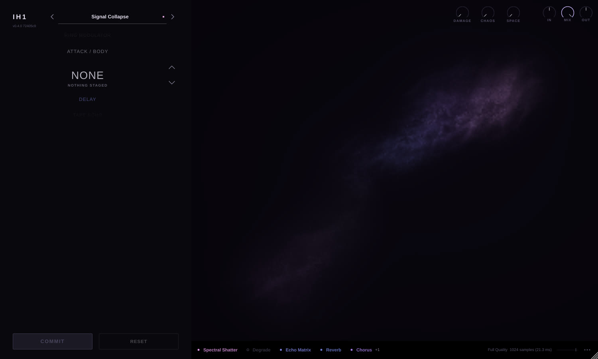

# IH1

A creative VST3 multi-FX plug-in built around a **commit workflow**. You scroll to an effect, shape it while it plays after everything you've already committed, then **COMMIT** it into an immutable serial chain. Each committed effect can be reordered or deleted but never edited, and the chain grows into an audio-reactive force field.



## Status

Version 0.6.0 (test build, feedback round 6). V6 is documented in `docs/V6_IMPLEMENTATION.md` (crash diagnosis:
`docs/V6_CRASH_ANALYSIS.md`; preset audit: `docs/V6_PRESET_AUDIT.md`); open items are in `docs/KNOWN_ISSUES.md` (V6
section). Earlier rounds: `docs/V5_IMPLEMENTATION.md`, `docs/V4_IMPLEMENTATION.md`, `docs/V3_IMPLEMENTATION.md`,
`docs/V2_1_IMPLEMENTATION.md`.

**New in V6:**
- **FL Studio crash fixed.** A right-click on the effect browser read one entry before the effect table (an
  out-of-bounds read since 0.4.0). It was found in the shipped 0.5.0 binary, proven with AddressSanitizer, and fixed;
  CI now runs the editor tests under AddressSanitizer.
- **Readable menus.** The preset browser no longer draws a category over the description, and names are no longer
  cut off. The FX list describes each effect.
- **67 effects.** Three are new and vocal: Vowel Morph (talkbox-style vowels), Whisper (singing into breath) and
  Vocal Throw (ducked, filtered adlib echoes with pitch drops, or Last Word throws).
- **246 factory presets.** A new Vocal / Voice category holds 37. The whole bank was audited by measurement
  (`tools/ih1_bank_audit`), and 13 older presets were corrected.
- **Voice macros** (Voice / Mouth / Throw) on vocal chains.

The V5 state, for reference:

**New in V5:**
- **COMMIT keeps the browser on the effect.** The committed copy plays; a fresh copy at its defaults waits, muted,
  for the next audition: touch a control or press M.
- **64 effects.** Nine are new: Cloud Chamber, Reflection Sculptor, Reverse Bloom, Swell, Pulse Shaper, Drum Crush,
  Drum Space, Band Transients and Hit Melody.
- **209 factory presets.** 61 are new, across atmosphere, drums / drum bus, and tremolo / groove.
- **Combination macros.** Macro knobs appear only when the chain combines effects in a meaningful way, named for
  what they do; every macro is tested to be audible.
- **Bounded feedback.** Every feedback loop decays (`tools/ih1_feedback_audit`).
- **Fewer clicks** in chopping and buffer effects.
- **FX tree.** It stays inside the panel, shakes less, and is a little more luminous.

The V4 state, for reference:

- **55 effects**, including ten new in V4: Slice Shuffler, Attack / Body, Echo Matrix, Reverse Pitch Echo,
  Dispersion, Modal Resonator, Texture Imprint, Spectral Shatter, Partial Recomposer and Spectral Graft.
- **148 factory presets** in ten sound-led categories, searchable by sound, source (vocals, drums, ...), intensity
  and style inspiration. Every preset except Init has 2-4 **performance macros** (host parameters Preset Macro 1-4)
  that move several of the chain's settings together at runtime; the committed settings themselves never change.
- **Click-free chopping:** a registry-wide click audit drove fixes in Glitch Scatter, Stutter, Time Warp, Reverse,
  Gate, Tremolo and the Grain Engine; continuous parameter changes now glide and discrete switches are crossfaded.
- **Workflow:** None is an ordinary entry of the effect carousel; click a committed effect's name to bypass / enable
  it (its settings are kept, Time & Space tails ring out); every recall lands on None; Init is a true empty state.
- **Formation:** one continuous, audio-reactive force-field medium (no per-effect centres) of filaments, ribbons and
  veils in the accepted palette, on a plum void; square artefacts removed (resolution floor, jittered accumulation,
  bicubic reconstruction, dither).
- **Output Safety:** Off / Guard (zero latency, default) / True Peak (lookahead, reported latency). No plug-in can
  guarantee speaker or hearing safety.
- **Tested on Linux:** unit / behaviour / audit tests, VST3 host-lifecycle checks, editor tests (GL and software),
  click audit. Windows CI builds, tests, runs pluginval and packages the setup wizard and the installer ZIP.
- **Not tested:** FL Studio and real GPUs. See `docs/FL_STUDIO_TEST_CHECKLIST.md`.

## Install (Windows)

1. Download `IH1-Setup-<version>.exe` from the latest **build** workflow run (artifact `IH1-windows-setup`) in GitHub Actions.
2. Run it. It installs `IH1.vst3` to `C:\Program Files\Common Files\VST3\` (the standard VST3 folder) and, optionally, the standalone app.
3. Rescan plug-ins:
   - FL Studio: *Options > Manage plugins > Find more plugins*.
   - Cubase: *Studio > VST Plug-in Manager*.

   IH1 appears as an effect from "R4N".
4. For Harmony's MIDI mode, route MIDI to IH1:
   - FL Studio: the plug-in's MIDI input port.
   - Cubase: a MIDI track whose output is IH1.

## Build from source

Requirements: CMake 3.22+, a C++20 compiler, Git.
- **Windows:** Visual Studio 2022 with *Desktop development with C++*.
- **Linux:** the ALSA/X11/freetype/OpenGL dev packages listed in `.github/workflows/build.yml`.

JUCE 9.0.5 and doctest are fetched automatically at pinned versions.

```bash
cmake -S . -B build -G "Visual Studio 17 2022" -A x64
```

```bash
cmake --build build --config Release --parallel
```

The build produces:
- `build/plugin/IH1_artefacts/Release/VST3/IH1.vst3`, the plug-in
- `build/plugin/IH1_artefacts/Release/Standalone/IH1(.exe)`, the standalone app
- `build/Release/ih1_tests(.exe)`, the unit and behaviour tests
- `build/plugin/ih1_hosttest_artefacts/Release/ih1_hosttest`, which loads the built VST3 and runs host-lifecycle checks
- `ih1_bench`, the CPU benchmark
- `formation_preview`, an offline render of the visual, e.g. `formation_preview out delay,reverb,harmony`
- `ih1_uitest`, the editor interaction test (needs a display: `xvfb-run` on Linux)
- `fx_dump`, which prints the FX parameter schema

To build the setup wizard locally, install Inno Setup 6, stage the files the same way CI does, then run `ISCC.exe /DAppVersion=0.6.0 /DTestRound=6 /DSourceDir=<stage> installer\IH1.iss`.

Optional: `-DIH1_JUCE_DIR=<path>` uses a local JUCE checkout instead of fetching it.

## Using IH1

- **Carousel:**
  - It shows `None` until you choose an effect.
  - Choose by scrolling the wheel over the names, with the ▲▼ arrows or the arrow keys, or by typing a name.
  - **Right-click** the carousel for the catalogue: categories open submenus beside them (hover, click, or arrow keys).
  - Every name is shown in the effect's colour, which it keeps in the formation.
  - Each effect type remembers its own draft settings.
- **Staged effect:** the selected effect plays *after* the committed chain. Its settings appear only while something is staged.
  - **S** (SOLO FX) plays only the staged effect.
  - **M** (MUTE FX) silences only the staged effect and greys the whole staged column until you unmute.
  - The staged effect never appears in the formation.
- **COMMIT** sends a frozen copy into the chain. A short transfer animation carries it into the formation. The carousel stays on the same effect with a fresh copy at its defaults, muted (V5): touch a control or press M to audition it.
- **RESET** restores the staged effect's defaults and clears what it holds, such as a Looper's recording or delay and reverb tails.
- **Settings:**
  - Graphs show the real response or state.
  - Double-click a knob to reset it, or double-click a value to type one.
  - Advanced controls are always visible under the *Advanced* label.
  - With **Sync** on, the free time or rate knob is greyed out (its value is kept); Division sets the time.
- **Chain strip** (under the formation):
  - Drag a name along the strip to reorder.
  - While dragging, a red **DELETE** appears at the upper-left of the field. Drop on it and confirm to remove that one instance. Escape, Cancel, or dropping anywhere else never deletes.
  - Hover a name for read-only details.
  - **···** at the right end of the strip (or right-click the strip) opens the chain options:
    - latency mode: Full Quality, Low Latency, or Zero Latency;
    - **Clear FX Chain…**, which always asks first. It removes every committed effect and keeps the staged one.
  - The quiet status next to it shows the latency reported to the host and, in Zero mode, which effect prevents strict zero.
- **Presets:**
  - The box in the header shows the current preset. Click the name to browse by category or search; ‹ › step through every preset and wrap.
  - Presets hold the committed chain.
  - User presets are saved to `Documents/IH1/Presets/*.ih1chain` (Save As, Save with confirmation, Rename, Delete).
  - Factory presets are read-only.
  - DAW projects additionally restore the staged draft, the selection, SOLO/MUTE and the editor size.
- **Host automation:** a fixed set of parameters — Bypass, SOLO, MUTE, Input / Output Gain, Global Mix, and Staged Control 1–8, which map to the staged effect's first eight controls. Committed effects are never automatable.
- **Without a GPU:** set `IH1_NO_OPENGL=1` to use the software formation. IH1 also switches to it automatically if OpenGL 3.2 is unavailable or a render target fails.

## Architecture and research

- `docs/ARCHITECTURE.md`: model, real-time handoff, state schema and parameters.
- `docs/KADAL_RESEARCH_MAP.md`: per-family research sources (KADAL IDs), chosen algorithms and gaps.
- `docs/VISUAL_REFERENCE_ANALYSIS.md`: measured analysis of the visual reference.
- `docs/OPEN_DECISIONS.md`: product decisions, all resolved.

The engine (`core/`) is plain C++20 with no JUCE dependency; `plugin/` is a thin JUCE 9 wrapper.

## Licensing

- **IH1:** the project's own licence has not been chosen yet; all rights are reserved by the owner.
- **JUCE 9:** used under the **JUCE 9 EULA, Starter tier**, which is free up to USD 20k revenue or funding. Move to Indie (or the AGPLv3 alternative) before passing that threshold.
- **VST3 SDK:** MIT.

- **Inno Setup:** the setup wizard is built with Inno Setup 6.7, which reports "Non-commercial use only". Buy an Inno Setup licence, or switch to NSIS or WiX, before selling IH1.

See `installer/THIRD_PARTY_NOTICES.txt`. VST is a registered trademark of Steinberg Media Technologies GmbH.

## Known limitations

See `docs/KNOWN_ISSUES.md` for the complete list. In short:

- **FL Studio is untested.** No V1 or V2.1 fix has been verified in FL Studio, and there is no DAW testing at all yet. Use `docs/FL_STUDIO_TEST_CHECKLIST.md`.
- **Display scaling is untested** at 125–200 %.
- **The visual is close to the reference, not identical.**
- **Spectral effects have no zero-latency variant.** Harmony, Pitch Shift, Formant Shift and Spectral Freeze add 2048 samples in Full Quality and 512 in Low; Zero mode names them.
- **Zero-mode saturation aliases more.** About 24 dB more at high drive, and Fold is very aliased. Low (5 samples) keeps full anti-aliasing.
- **The chain is capped at 32 effects.**
- **macOS is not built yet.**
