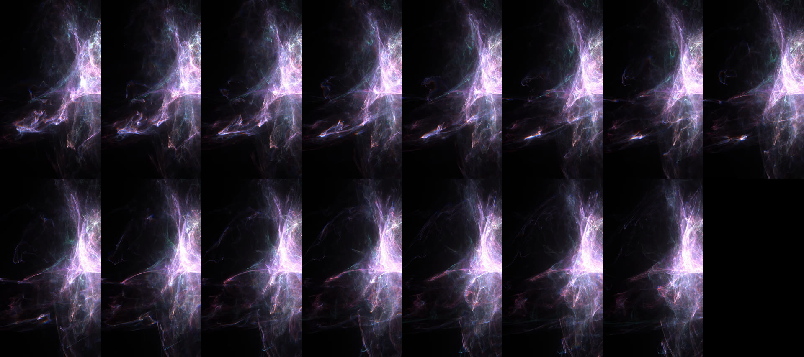
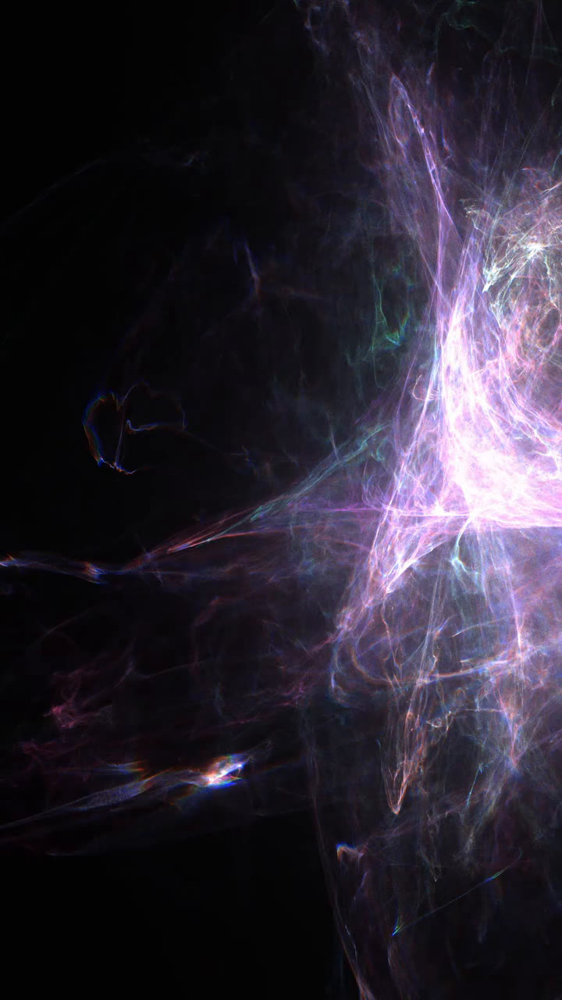

# Visual Reference Analysis

**Source:** `references/ih1_visual_reference.mp4` (supplied by user; 720×1280 portrait, 30 fps, 915 frames, 30.65 s, H.264 + audio track).
**Sketch:** `references/ih1_ui_sketch.png`.
**Method:** full-length frame sampling (1 frame / 2 s contact sheet, 2 fps numeric analysis over all 61 samples), plus full-resolution inspection of individual frames. Numbers below come from `ffmpeg` raw RGB extraction + NumPy, not eyeballing.

## 1. Measured properties

| Property | Value | Implication for IH1 |
|---|---|---|
| Mean luma | 0.174 (median 0.069) | Mostly dark; brightness is concentrated, not spread. |
| Pixels with luma < 0.05 | 42 % | Large regions of true near-black must remain. Additive blending must not lift the floor. |
| 99th-percentile luma | 0.957 | Hot cores do reach near-white — but only in small areas. |
| Brightness-energy centroid | x = 0.82 W, y = 0.46 H | Strongly asymmetric: the mass sits off-centre (right of frame, mid-height). Not a centred radial form. |
| Hue distribution (px with luma > 0.12) | 210–240°: 10.9 % · **240–270°: 51.3 %** · **270–300°: 27.0 %** · 300–330°: 8.3 % · 330–360°: 1.3 % · 180–210°: 0.9 % · everything else ≈ 0 | Palette is a narrow **blue → indigo → violet → magenta** arc. Cyan/teal is a trace accent (< 1 %), not a co-equal colour. No green, yellow or orange. |
| Median saturation (lit px) | 0.28 | Pastel / smoky, **not neon**. Saturation should be low-to-moderate; highlights desaturate toward white. |
| Mean abs. frame difference (0.5 s step) | 0.011 (max 0.013) | Slow, steady, continuous motion; no cuts, flashes, or pulsing. |

### Tone ladder (mean colour per luma band)

| Luma band | Share of frame | Mean colour | Role |
|---|---|---|---|
| 0.02–0.08 | 28.6 % | `#0b090e` | Background floor (slightly violet-black, not pure black) |
| 0.08–0.20 | 19.4 % | `#1f1b27` | Smoky haze / deep field |
| 0.20–0.45 | 13.2 % | `#4b435c` | Dim filaments, desaturated violet-grey |
| 0.45–0.75 | 8.0 % | `#937fab` | Main filaments, lavender-violet |
| 0.75–1.00 | 5.2 % | `#e5caf2` | Highlight cores, pale lavender-white |

## 2. Qualitative structure (from full-resolution frames)

- **Multi-scale filaments.** Three clear layers: (a) hair-thin bright strands with sharp edges, (b) mid-width translucent ribbons/sheets that fold over themselves, (c) wide, very faint smoke that fills the gaps.
- **Dense core + long tendrils.** One luminous mass (right-of-centre) with thin tendrils reaching far left across black space; a strong near-horizontal "seam" of light around mid-height crosses the frame.
- **Brightness comes from overlap.** The hottest areas are where many translucent strands cross — an additive-accumulation look, not individually bright particles.
- **Chromatic edge fringing.** Isolated strands show thin cyan/teal and magenta/orange fringes along their edges (prism-like dispersion). This is where the trace cyan/teal and the ~0.2 % warm hues come from. It reads as iridescence, not as separate colour regions.
- **Motion.** Slow drift and gentle folding; strands keep their identity across frames, ends curl and unfurl. No beat-pulsing, no random respawning, no camera cuts. Over 30 s the overall silhouette changes modestly while detail churns continuously.
- **Not present:** grids, nodes, dots, stars, planets, radial spectra, symmetry.

## 3. Rendering constraints derived for IH1

1. **Background** `#0a080d`-ish; keep ≥ ~35–45 % of the canvas below luma 0.05 even with a large chain.
2. **Per-FX colours** are drawn only from the measured hue arc ≈ **215°–325°**, saturation ≈ 0.2–0.55 for body colour, converging to near-white (`#e5caf2`-like) at overlaps. Cyan/teal and warm tints are reserved for thin edge fringing only. Proposed family anchors (to be tuned against frames during Phase 5):

   | FX family | Hue anchor | Body colour (example) |
   |---|---|---|
   | Time / space (Delay, Tape Echo, Reverse) | ~225° | icy periwinkle `#8f9fd8` |
   | Reverb / Shimmer / Convolution | ~245° | blue-lavender `#9a94d6` |
   | Pitch / voice (Harmony, Pitch, Formant…) | ~265° | violet `#a48bd4` |
   | Modulation (Chorus, Flanger, Phaser…) | ~280° | lavender-purple `#b08ccc` |
   | Texture / spectral (Granular, Freeze, Stutter) | ~300° | orchid `#c08bc6` |
   | Tone / dynamics (EQ, Saturation, Comp…) | ~318° | muted magenta `#c587b2` |

   Duplicates of a type shift hue by a few degrees and use a different spatial sub-region, staying in their family.
3. **Asymmetry:** the formation's centre of mass sits off-centre in the canvas (the landscape canvas allows it to drift around ~60–70 % width), growing outward with tendrils as the chain lengthens.
4. **Accumulation rendering:** render many low-alpha strands into an HDR/float accumulation buffer, persistent with slow decay (trails), then tone-map (soft-knee) so overlaps bloom to pale lavender-white rather than clipping to saturated colour.
5. **Motion budget:** visual change per 0.5 s should stay in the ~1 % mean-luma range at rest; audio energy may raise activity/brightness but via smoothed (attack/release) envelopes only.
6. **SOLO:** committed strands lerp saturation → 0 and brightness down toward the `#1f1b27`–`#4b435c` range, then fade out.
7. **Empty chain:** only the `#0a080d` floor (optionally an almost invisible haze), no strands.

## 4. Sketch notes (`references/ih1_ui_sketch.png`)

- Left column (~35 % width): carousel (previous/next names faded above/below the selected name, ▲▼ arrows to the right), a bordered settings panel with **S** (SOLO FX) and **M** (MUTE FX) toggles at its top-right, COMMIT and RESET below.
- Right area (~65 %): the formation field. Sketch annotations: "no fx = empty", "fx = formation of supercluster", "more fx = bigger formation / less fx = smaller formation", "colour of the parts of the formation is supposed to be of the committed fx".
- The sketch is white with black text; it is a layout sketch only. The video governs colour/mood, so the whole editor will be dark-themed.
